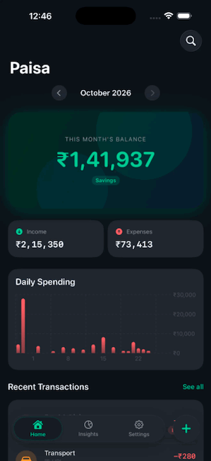
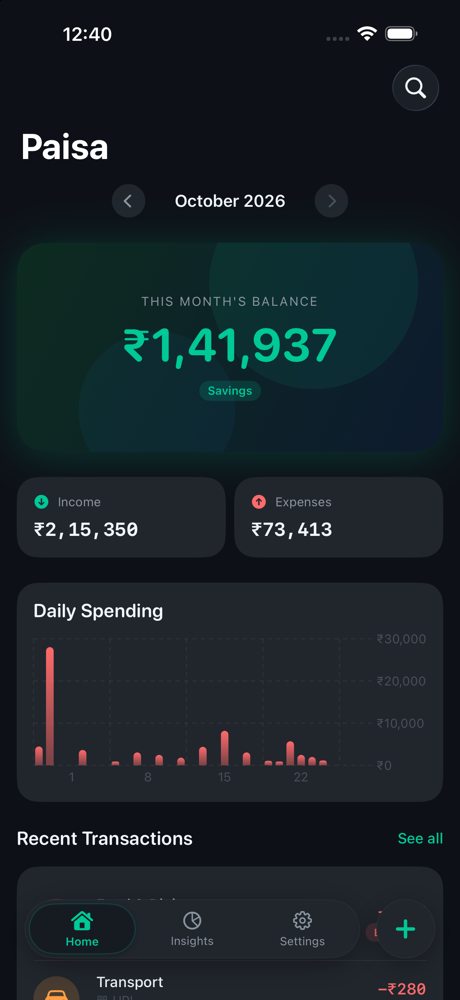
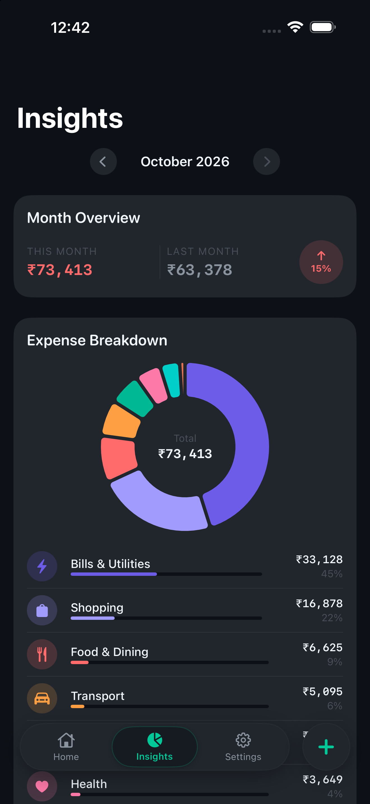
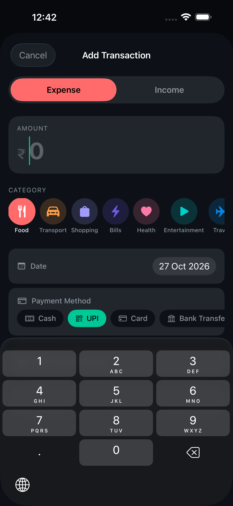
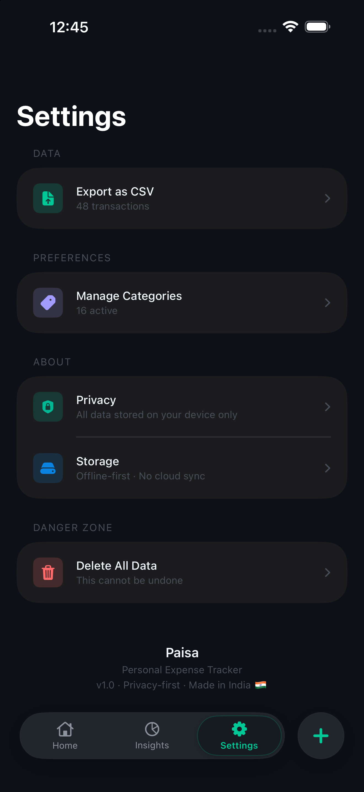

# Paisa (पैसा) 💰

[](https://github.com/VasuChovatiya/Paisa/actions/workflows/ci.yml)

> **iOS-first · SwiftUI · Offline-first · Privacy-first · India-ready Personal Expense Tracker**

Paisa is a native iOS expense tracker built from the ground up for speed, privacy, and precision. It stores financial amounts in integer minor units (paise), ensures total offline privacy with SwiftData, and features rich native visualizations with Swift Charts.

---

## 📱 Screenshots & Preview

<p align="center">
  
</p>

| Dashboard | Insights | Add Expense | Settings |
|:---:|:---:|:---:|:---:|
|  |  |  |  |

---

## ✨ Features

- **⚡️ Blazing Fast Native UI**: Pure SwiftUI with `@Observable` architecture and smooth spring animations.
- **🔒 100% Offline & Private**: Zero analytics, zero third-party tracking, zero network requests. Your financial data stays strictly on your device.
- **₹ Minor-Unit Arithmetic**: All monetary values are calculated in integer paise (`₹125.50` stored as `12550`) to avoid floating-point rounding errors.
- **📊 Swift Charts Visualizations**: Monthly category breakdowns, spending trends, and month-over-month comparisons.
- **🏷️ Smart Category Management**: Soft-archive categories to preserve historical spending records without breaking integrity.
- **📄 RFC 4180 CSV Export**: Foundation-based data export with built-in formula injection sanitization (`=`, `+`, `-`, `@`).
- **🛡️ Supply-chain Security**: Scanned with custom XCSSET malware guards before commits.

---

## 🛠️ Architecture & Tech Stack

| Layer | Choice |
|---|---|
| **UI Framework** | SwiftUI + `@Observable` (iOS 17.6+) |
| **Persistence** | SwiftData (`@Model`) |
| **Visualizations** | Swift Charts |
| **Architecture** | MVVM |
| **Export** | Native Foundation CSV (RFC 4180 compliant) |
| **Testing** | XCTest Suite |
| **Dependencies** | None (Zero third-party packages) |

---

## 📁 Project Structure

```
Paisa/
├── Config/                  # App configurations & Info.plist
├── Paisa/
│   ├── App/                 # App lifecycle entry point & scene
│   ├── Core/
│   │   ├── DesignSystem/    # Typography, Spacing, Colors & UI Components
│   │   └── Extensions/      # Helpers for Date, Color, and Currency formatting
│   ├── Data/
│   │   ├── Models/          # SwiftData @Model entities (Transaction, Category)
│   │   └── Persistence/     # ModelContainer configuration & seeding
│   ├── Features/
│   │   ├── Dashboard/       # Overview, monthly balance, recent transactions
│   │   ├── Insights/        # Visual charts, category breakdowns, trends
│   │   ├── AddExpense/      # Quick entry sheet with category picker
│   │   ├── Transactions/    # Search, filter, and history list
│   │   └── Settings/        # CSV export, demo data loading, data management
│   └── Services/
│       ├── ExpenseCalculator.swift     # Pure minor-unit math
│       ├── MonthlySummaryService.swift # Monthly aggregation
│       └── CSVExportService.swift      # Secure CSV generation
├── PaisaTests/              # Unit tests for calculation, summary, and export
├── Screenshots/             # Visual assets and previews
└── scripts/
    └── check-xcsset.sh      # Security malware guard
```

---

## 🚀 Getting Started

### Prerequisites
- Xcode 27 or later (the project uses Xcode 27's project format)
- iOS 17.6+ Simulator or Device

### Running the App
1. Clone the repository:
   ```bash
   git clone https://github.com/VasuChovatiya/Paisa.git
   cd Paisa
   ```
2. Open `Paisa.xcodeproj` in Xcode:
   ```bash
   open Paisa.xcodeproj
   ```
3. Select an iOS 17.6+ simulator or device.
4. Press `Cmd + R` to build and run.

---

## 🧪 Testing

Run the test suite using Xcode (`Cmd + U`) or the command line:

```bash
xcodebuild test \
  -project Paisa.xcodeproj \
  -scheme Paisa \
  -destination 'platform=iOS Simulator,name=iPhone 16'
```

---

## 📄 License

This project is open-source and available under the [MIT License](LICENSE).

